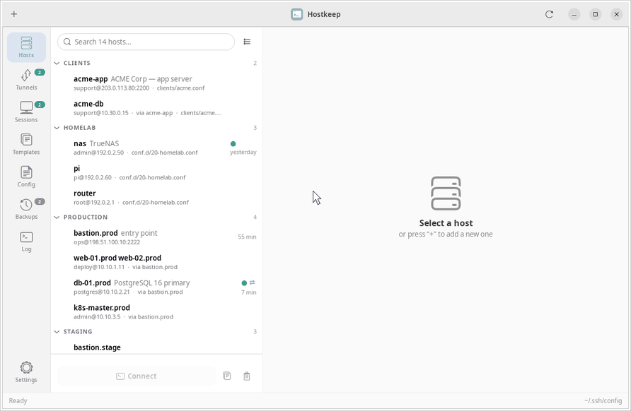
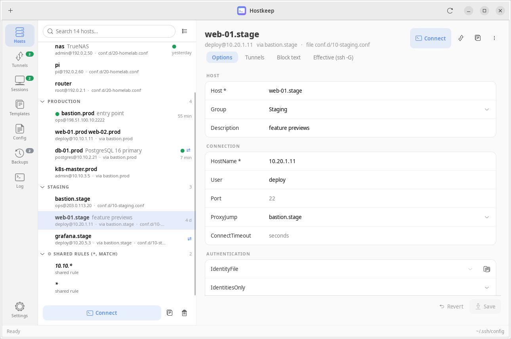
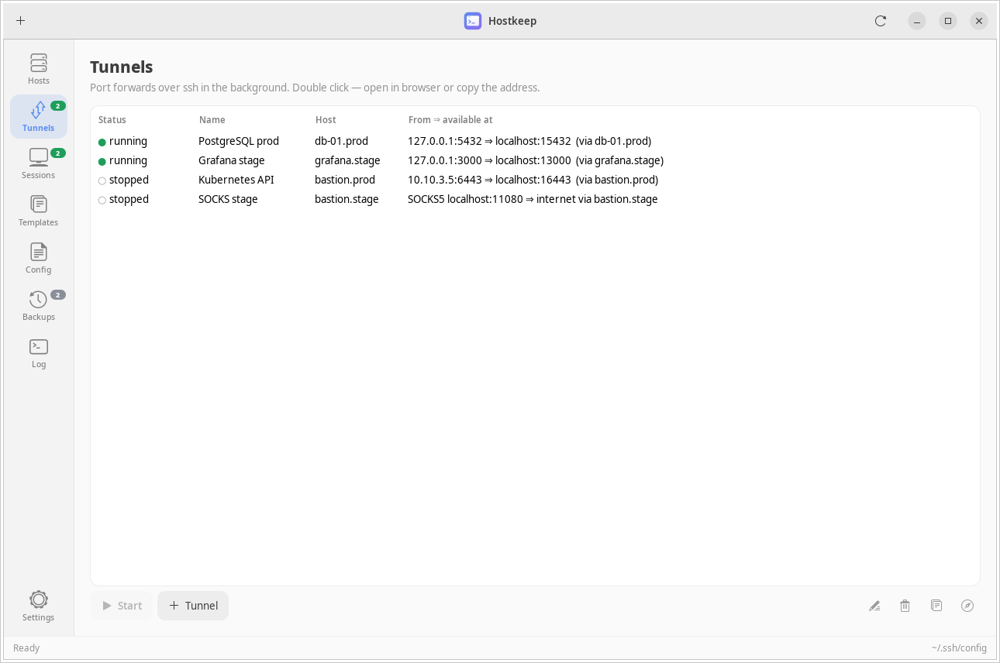
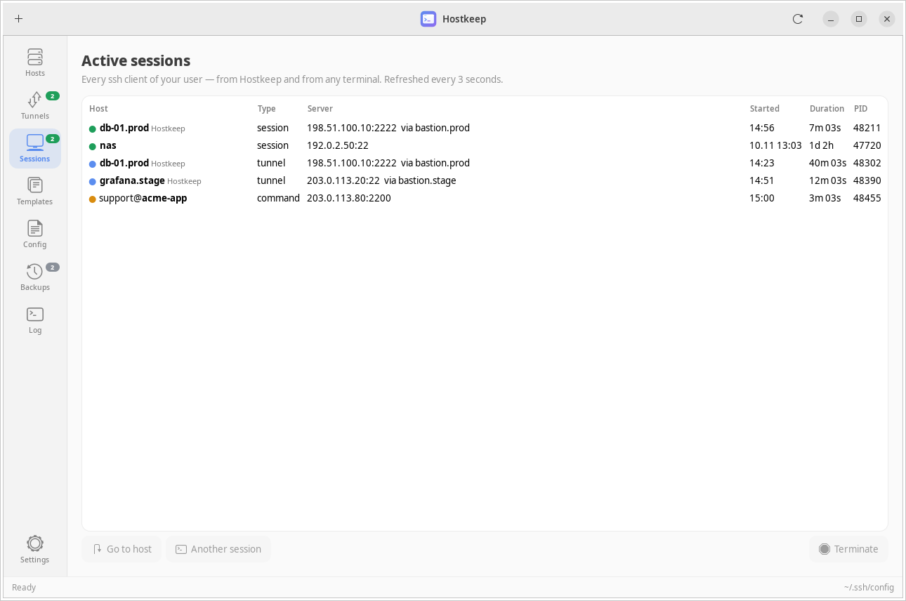
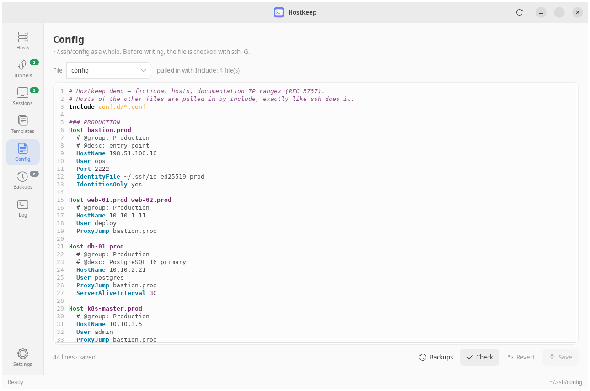
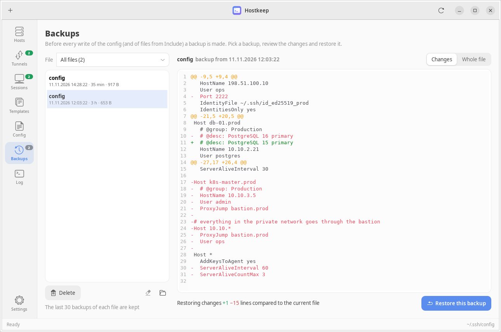
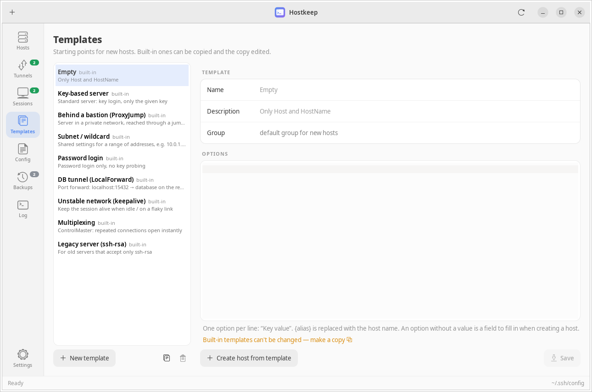
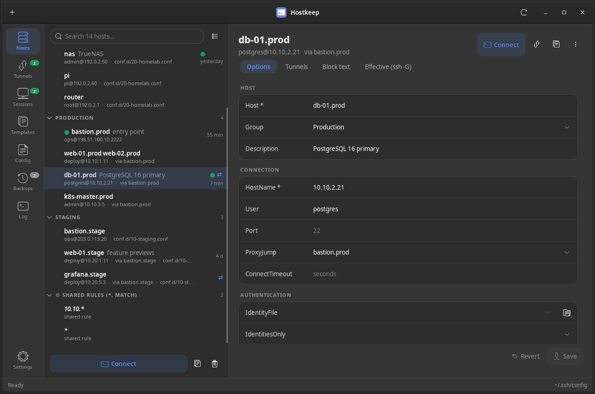

<p align="center">
  
</p>

<h1 align="center">Hostkeep</h1>

<p align="center">
  <b>A native Linux desktop app for <code>~/.ssh/config</code> — hosts, sessions and tunnels in one window,<br>
  without ever breaking the file you wrote by hand.</b>
</p>

<p align="center">
  <a href="https://github.com/qnsi337/hostkeep/actions/workflows/ci.yml"></a>
  
  
  
  
</p>

<p align="center">
  <a href="README.ru.md">🇷🇺 Русская версия</a>
</p>



<sub>Search → edit a host → save (validated by <code>ssh -G</code>, backed up) → tunnels → backups diff → dark theme.
Recorded on the bundled demo config with <code>tools/demo_gif.py</code>.</sub>

Hostkeep is a GTK 3 front-end for the SSH client you already use. It reads and
edits your real `~/.ssh/config` (including every file pulled in with
`Include`), opens sessions in **your own terminal**, runs port forwards in the
background and shows every live `ssh` process — no accounts, no sync, no
separate host database, no lock-in. Close Hostkeep and plain `ssh` keeps working
exactly the same.

## Why another SSH manager?

Most GUI managers either keep their own host list or rewrite `~/.ssh/config`
from their own model, losing comments, ordering and formatting. Hostkeep works
the other way round:

- **Lossless editing.** The file is kept line by line. Everything you did not
  touch — comments, commented-out hosts, indentation, odd spacing, a missing
  final newline, non-ASCII text — is written back byte for byte. Only the
  lines you changed are regenerated.
- **ssh is the judge.** Before every write the new file is checked with
  `ssh -G`. If OpenSSH rejects it, nothing is written.
- **Backups and atomic writes.** Each save first copies the current file to
  `~/.config/hostkeep/backups/` (30 per file), then replaces it atomically,
  keeping its permissions and following symlinks. External edits are detected
  and never silently overwritten.
- **Metadata stays invisible to ssh.** Groups and descriptions are stored as
  comments (`# @group: Production`) and are only added if you set them.

## Features

| | |
|---|---|
| **Hosts** — grouped, searchable list (by label, by name prefix or by file). A settings-style form for the common options plus a table for any other keyword, a raw-text tab and an *effective config* tab (`ssh -G`) that shows what ssh will really use after `Host *` and first-match-wins. Required fields are validated as you type. |  |
| **Tunnels** — saved `-L` / `-R` / `-D` forwards that run in the background (`ssh -N`) with live status, auto-reconnect, autostart, one-click *open in browser* / *copy address*, and a tray menu. Port presets for PostgreSQL, Redis, Kubernetes API, Grafana and more; free local ports are picked automatically. |  |
| **Sessions** — every running `ssh` client of your user, from Hostkeep or any terminal: real server address, jump host, kind (session / command / tunnel / ControlMaster), duration. Jump to the host, open another session or terminate one. |  |
| **Config & Include** — the whole file with syntax highlighting and line numbers (GtkSourceView). `Include` is resolved like OpenSSH does it: `~`, paths relative to `~/.ssh`, globs, nested includes. Hosts from included files are editable and are saved back into *their* file. |  |
| **Backups** — every version before every write; see exactly what a restore would change (diff against the current file) and roll back in one click. |  |
| **Templates** — built-in and your own (bastion host, subnet wildcard, DB tunnel, keepalive, ControlMaster, legacy `ssh-rsa`…). Create hosts from them or apply one to an existing host. |  |

Also: double-click opens `ssh <host>` in GNOME Terminal, Konsole, Ptyxis,
kgx, Tilix, Alacritty, kitty, WezTerm, foot, xterm or any command you set;
the terminal stays open if ssh fails so you can read the error. Duplicate a
host, test key-based login (`BatchMode`), run `ssh-copy-id`, open files over
SFTP, tray icon with recent hosts. English and Russian UI, light / dark /
system theme — both switchable in Settings.

<p align="center"></p>

## Install

Hostkeep is plain Python + PyGObject, nothing to compile.

**Debian / Ubuntu**

```bash
sudo apt install python3-gi gir1.2-gtk-3.0 gir1.2-gtksource-4 openssh-client
# optional: tray icon
sudo apt install gir1.2-ayatanaappindicator3-0.1
```

**Fedora**

```bash
sudo dnf install python3-gobject gtk3 gtksourceview4 openssh-clients libayatana-appindicator-gtk3
```

**Arch Linux**

```bash
sudo pacman -S python-gobject gtk3 gtksourceview4 openssh libayatana-appindicator
```

Then:

```bash
git clone https://github.com/qnsi337/hostkeep.git
cd hostkeep
./bin/hostkeep          # run from the checkout
./install.sh            # optional: app-menu entry, icon and ~/.local/bin/hostkeep
```

`./uninstall.sh` removes the launcher again (your data and `~/.ssh` are left alone).
GtkSourceView and AppIndicator are optional — without them you get a plain
editor and no tray icon.

## Try it without touching your config

```bash
./examples/run-demo.sh
```

starts Hostkeep on a temporary copy of [`examples/demo-ssh`](examples/demo-ssh)
— a config that pulls hosts from `conf.d/*.conf` and a nested `clients/*.conf`.
Your real `~/.ssh/config` and `~/.config/hostkeep` are not used.

## How `Include` is handled

- Resolution follows OpenSSH: `~` is expanded, relative paths are relative to
  `~/.ssh`, globs are expanded in alphabetical order, nesting works (up to 16
  levels, like ssh). Hosts appear in the order ssh reads them.
- Editing a host writes only the file that contains it, with its own
  validation, backup and external-change check.
- *New host* lets you choose the target file; *Config* lets you open and edit
  any included file; the hosts list can be grouped by file.
- A cycle of includes does not hang Hostkeep; ssh itself rejects it, and the
  validation on save will tell you so.
- `Include` inside a `Host`/`Match` block is resolved too; its hosts are
  shown after that block.

## Keyboard

| Shortcut | Action |
|---|---|
| `Ctrl+1` … `Ctrl+7` | Hosts, Tunnels, Sessions, Templates, Config, Backups, Log |
| `Ctrl+F` | Search hosts (`Enter` connects to the first match) |
| `Ctrl+N` | New host / tunnel / template (depends on the page) |
| `Ctrl+S` | Save |
| `Delete` | Delete the selected host |

## Files

| Path | What |
|---|---|
| `~/.ssh/config` (+ includes) | your config, edited in place |
| `~/.config/hostkeep/state.json` | settings, connection stats, tunnels |
| `~/.config/hostkeep/templates.json` | your templates |
| `~/.config/hostkeep/backups/` | backups, 30 per file |

Environment variables `HOSTKEEP_CONFIG` and `HOSTKEEP_DATA` point Hostkeep at
another config file / data directory (handy for testing).

## Status and limitations

Hostkeep is young (0.1) but used daily on a hand-written config of 80+ hosts.

- The UI is available in **English** and **Russian**. New languages are a
  single JSON file — see [CONTRIBUTING.md](CONTRIBUTING.md#translations).
- Linux only (GTK 3, `/proc`). GNOME, KDE, XFCE and others work; the tray
  icon needs AppIndicator support.
- `Match` blocks are edited as text only.
- Passwords are never stored. Background tunnels use your ssh-agent; if a key
  needs a passphrase, a small dialog asks for it (`SSH_ASKPASS`).

## Development

```bash
python3 -m unittest discover -s tests -v     # backend tests, no GTK needed
xvfb-run -a python3 tools/screenshots.py     # regenerate docs/screenshots
xvfb-run -a python3 tools/demo_gif.py        # regenerate docs/demo.gif
```

```
bin/hostkeep            launcher
hostkeep/backend.py     config model (lossless parser, Include), validation, backups,
                        tunnels, session discovery, terminals — no GTK imports
hostkeep/app.py         GTK 3 user interface
hostkeep/askpass.py     SSH_ASKPASS dialog for background tunnels
hostkeep/i18n.py        translation layer, hostkeep/locale/*.json — catalogs
hostkeep/data/          GtkSourceView language definition for ssh_config
examples/               demo config with Include + run-demo.sh
tests/                  unit tests
```

See [CONTRIBUTING.md](CONTRIBUTING.md). Bug reports and pull requests are welcome.

## License

[MIT](LICENSE)
