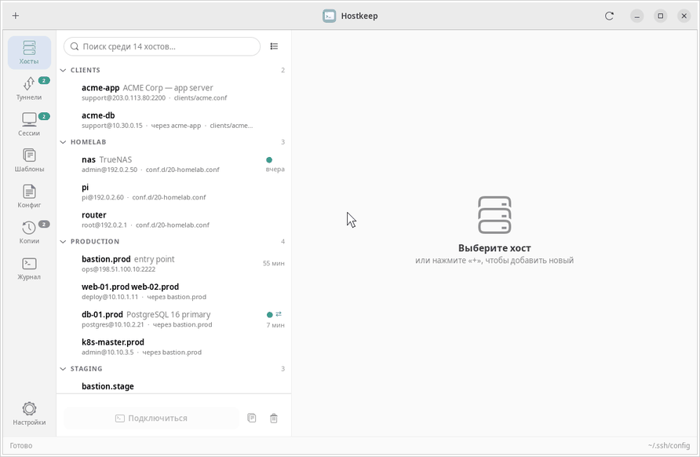
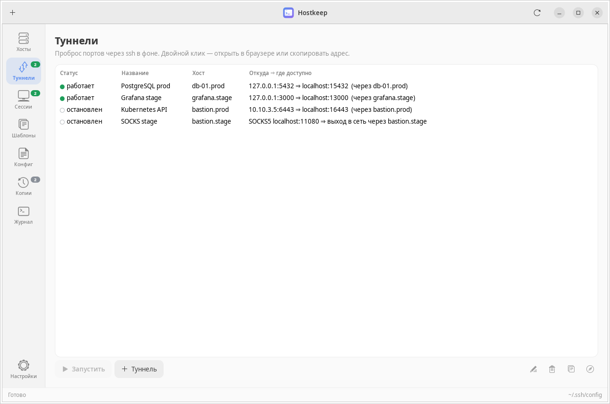
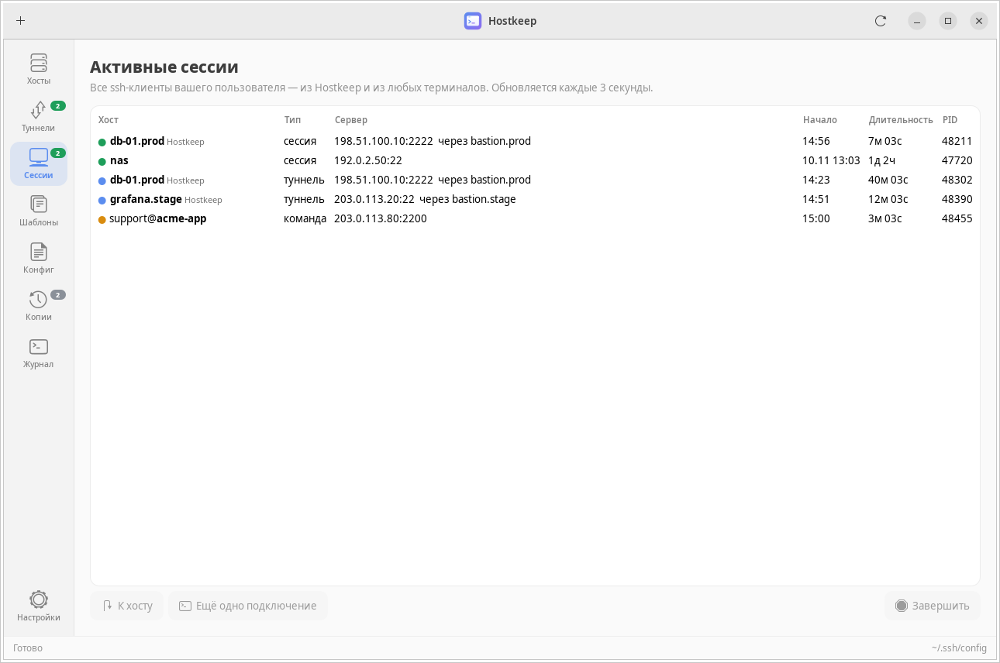
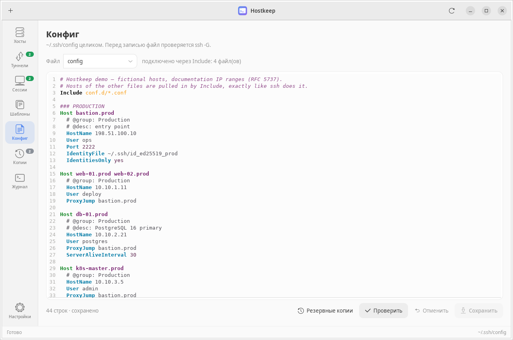
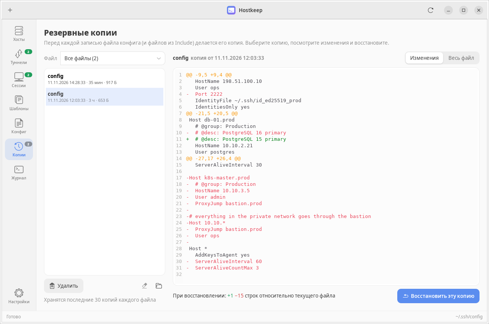

<p align="center">
  
</p>

<h1 align="center">Hostkeep</h1>

<p align="center">
  <b>Нативное Linux-приложение для <code>~/.ssh/config</code>: хосты, сессии и туннели в одном окне —<br>
  и ваш файл, написанный руками, остаётся целым.</b>
</p>

<p align="center"><a href="README.md">🇬🇧 English version</a></p>



<sub>Поиск → правка хоста → сохранение (с проверкой <code>ssh -G</code> и копией) → туннели → diff резервной копии →
тёмная тема. Записано на демо-конфиге скриптом <code>tools/demo_gif.py</code>.</sub>

Hostkeep — GTK 3 интерфейс к обычному OpenSSH. Он работает прямо с вашим
`~/.ssh/config` (и со всеми файлами из `Include`), открывает сессии в **вашем
терминале**, держит пробросы портов в фоне и показывает все живые
ssh-подключения. Никаких аккаунтов, синхронизации и отдельной базы хостов:
закрыли Hostkeep — `ssh` работает так же, как раньше.

## Чем отличается

- **Правка без потерь.** Файл хранится построчно: всё, что вы не трогали
  (комментарии, закомментированные хосты, отступы, кириллица, отсутствие
  перевода строки в конце), записывается обратно байт в байт. Меняются только
  изменённые строки.
- **Последнее слово за ssh.** Перед каждой записью файл проверяется `ssh -G`;
  если OpenSSH его не принимает — файл не трогается.
- **Резервные копии и атомарная запись.** Перед сохранением делается копия в
  `~/.config/hostkeep/backups/` (по 30 на файл), запись атомарная, права файла
  и symlink сохраняются. Изменения из другого редактора замечаются и не
  перезаписываются молча.
- **Метаданные невидимы для ssh.** Группа и описание хранятся комментариями
  (`# @group: Production`) и появляются, только если вы их заполнили.

## Возможности

- **Хосты** — список с группами (по меткам, по префиксу имени, по файлам) и
  поиском; форма в стиле настроек GNOME для основных параметров, таблица для
  любых других, вкладки «Текст блока» и «Итог (ssh -G)» — что ssh применит на
  самом деле. Обязательные поля подсвечиваются.
- **Туннели** — сохранённые пробросы `-L` / `-R` / `-D` в фоне (`ssh -N`):
  статус, переподключение при обрыве, автозапуск, двойной клик — открыть в
  браузере или скопировать адрес, управление из трея. Типовые сервисы
  (PostgreSQL, Redis, Kubernetes API, Grafana…) подставляют порты, свободный
  локальный порт подбирается сам.
- **Сессии** — все запущенные ssh-клиенты вашего пользователя, из Hostkeep и
  из любых терминалов: реальный сервер, бастион, тип, длительность; перейти к
  хосту, открыть ещё одну сессию, завершить.
- **Конфиг и Include** — файл целиком с подсветкой синтаксиса и номерами строк
  (GtkSourceView). `Include` разворачивается по правилам OpenSSH; хосты из
  подключённых файлов редактируются и сохраняются в *свой* файл.
- **Копии** — версия перед каждой записью; видно, что именно изменится при
  восстановлении, откат в один клик.
- **Шаблоны** — встроенные и свои; создание хостов по шаблону и применение
  шаблона к существующему хосту.
- Двойной клик открывает `ssh <хост>` в GNOME Terminal, Konsole, Ptyxis, kgx,
  Tilix, Alacritty, kitty, WezTerm, foot, xterm или в вашей команде; при ошибке
  окно не закрывается. Дублирование хоста, проверка входа по ключу,
  `ssh-copy-id`, SFTP, трей, светлая и тёмная темы.

| | |
|---|---|
|  |  |
|  |  |

## Установка

**Debian / Ubuntu**

```bash
sudo apt install python3-gi gir1.2-gtk-3.0 gir1.2-gtksource-4 openssh-client
sudo apt install gir1.2-ayatanaappindicator3-0.1   # необязательно: значок в трее
```

**Fedora:** `sudo dnf install python3-gobject gtk3 gtksourceview4 openssh-clients libayatana-appindicator-gtk3`
**Arch:** `sudo pacman -S python-gobject gtk3 gtksourceview4 openssh libayatana-appindicator`

```bash
git clone https://github.com/qnsi337/hostkeep.git
cd hostkeep
./bin/hostkeep      # запуск из папки
./install.sh        # ярлык в меню приложений, иконка, ~/.local/bin/hostkeep
```

`./uninstall.sh` убирает ярлык (данные и `~/.ssh` не трогает).

## Попробовать, не трогая свой конфиг

```bash
./examples/run-demo.sh
```

Запускает Hostkeep на временной копии [`examples/demo-ssh`](examples/demo-ssh):
конфиг подключает хосты из `conf.d/*.conf` и вложенного `clients/*.conf`.

## Как работает Include

- Как в OpenSSH: `~` раскрывается, относительные пути — от `~/.ssh`, маски
  раскрываются по алфавиту, вложенность до 16 уровней. Хосты идут в том
  порядке, в каком их читает ssh.
- Правка хоста меняет только его файл — со своей проверкой, копией и
  контролем внешних изменений.
- При создании хоста можно выбрать файл; в разделе «Конфиг» — открыть любой
  подключённый файл; список хостов можно сгруппировать по файлам.
- Цикл Include не вешает приложение; ssh сам такой конфиг отвергает, и
  проверка при сохранении об этом скажет.

## Горячие клавиши

`Ctrl+1…7` — разделы, `Ctrl+F` — поиск (`Enter` — подключиться к первому
найденному), `Ctrl+N` — новый хост / туннель / шаблон, `Ctrl+S` — сохранить,
`Delete` — удалить хост.

## Файлы

- `~/.config/hostkeep/state.json` — настройки, статистика, туннели
- `~/.config/hostkeep/templates.json` — ваши шаблоны
- `~/.config/hostkeep/backups/` — резервные копии (по 30 на файл)

`HOSTKEEP_CONFIG` и `HOSTKEEP_DATA` задают другой конфиг и каталог данных.

## Ограничения

- Интерфейс на русском и английском; язык и тема (светлая / тёмная / как в
  системе) выбираются в настройках. Новый язык — один JSON-файл, см. CONTRIBUTING.
- Только Linux; для значка в трее нужен AppIndicator.
- `Match`-блоки редактируются только как текст.
- Пароли не сохраняются. Фоновые туннели используют ssh-agent; если ключу
  нужна passphrase — появится окно ввода (`SSH_ASKPASS`).

## Разработка

```bash
python3 -m unittest discover -s tests -v
xvfb-run -a python3 tools/screenshots.py [--lang=ru]
xvfb-run -a python3 tools/demo_gif.py [--lang=ru]
```

## Лицензия

[MIT](LICENSE)
